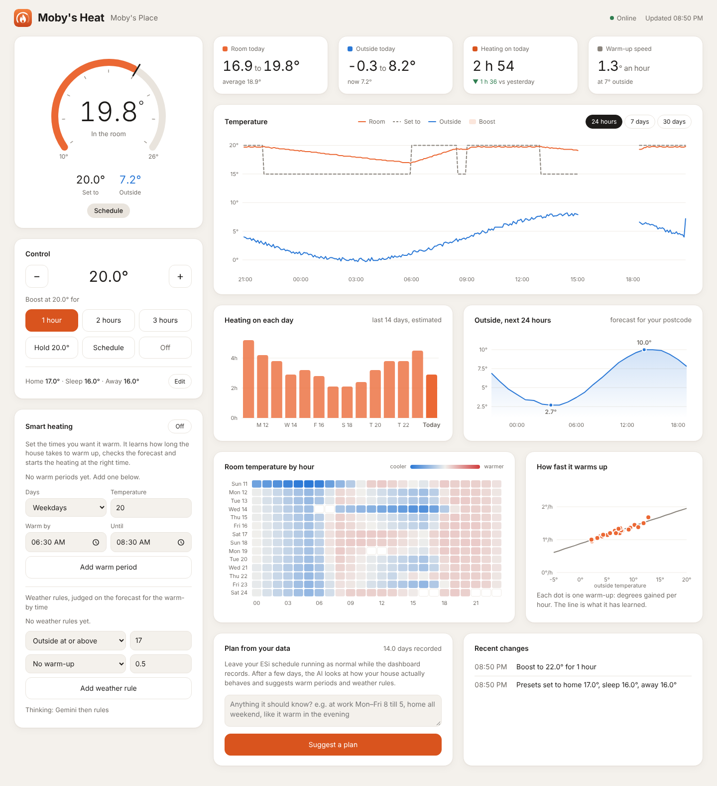

<p align="center"></p>

# Moby's Heat

A home heating dashboard for the **ESi Centro** smart thermostat, written in Python.

It shows how warm the house is, how warm it is outside, and how the two have moved over the last day, week or month. You can boost, hold or switch off the heating from any browser, and an optional "smart heating" mode learns how long your house takes to warm up and starts the heating at the right time, with help from Gemini or Claude.



*The screenshots use two weeks of made-up readings.*

## What it does

- **Live view**: room temperature on a dial, what it's set to, the outside temperature, the mode, a boost countdown and a low battery warning.
- **Controls**: boost for 1, 2 or 3 hours, hold a temperature, back to schedule, off, and edit the home / sleep / away presets.
- **History**: a reading every 5 minutes, kept for 90 days. Charts for temperature over time, hours of heating per day, a 24-hour outside forecast, room temperature by hour of day, and how fast the house warms up.
- **Smart heating** (optional, off until you switch it on): you set when you want it warm, for example "weekdays, 20° from 06:30 until 08:30". It learns how fast the house warms up, and how much slower that is in the cold, then decides when to start. Weather rules can skip a warm-up on a mild day or add a little when it's freezing.
- **Plan from your data**: after a few days of recording, an AI looks at how your house actually behaves and suggests warm periods and weather rules. You decide whether to use them.
- **Works on a phone** and installs to the home screen with its own icon. Light and dark themes follow your device.
- **Your own web address** (optional) through a Cloudflare tunnel, protected by a PIN, with nothing opened on your router.

## How the smart heating stays safe

The code sets the limits and the AI only chooses the timing within them. It never starts more than 3 hours early, never heats above the temperature you set, and if the AI keeps saying "wait" past the last sensible moment, plain rules start the heating anyway. If neither AI answers, the rules decide on their own.

It drives the heating with 1-hour boosts that it tops up. If the computer running Moby's Heat stops, or the internet drops, the boost runs out and the thermostat goes back to its own ESi schedule within the hour. If someone changes the heating by hand, on the dashboard or in the ESi app, smart heating steps back until that warm period is over.

## Setting it up

You need Python 3.10 or newer and an ESi Centro thermostat set up in the ESi Centro app.

```
pip install -r requirements.txt
```

Copy `heating_config.example.ini` to `heating_config.ini` and fill in your ESi email and password, and your postcode for the weather. Then:

```
python heating_dashboard.py
```

and open http://localhost:8080.

Everything else in the settings file is optional:

| Section | What it's for |
|---|---|
| `[dashboard]` | A PIN, sharing on your home network, and the port |
| `[location]` | Your postcode, for the outside temperature and forecast |
| `[cloudflare]` | Your own web address (see below) |
| `[ai]` | Gemini and Claude keys for smart heating. Leave blank to use the rules only |

`heating_config.ini` holds your ESi password in plain text, so keep it private. It's already in `.gitignore`.

### On your phone

Open the dashboard in Chrome on Android, then choose **Add to Home screen** (or **Install app**) from the menu. It gets the Moby's Heat icon and opens full screen.

### Your own web address

If you have a domain on Cloudflare and `cloudflared` installed and logged in, set up a tunnel once:

```
cloudflared tunnel create heating-dashboard
cloudflared tunnel route dns heating-dashboard heat.example.co.uk
```

Then put the address in `heating_config.ini`:

```
[cloudflare]
hostname = heat.example.co.uk
tunnel = heating-dashboard
```

Moby's Heat then starts the tunnel by itself. Because the page controls your heating, it won't start the web address without a PIN of at least 6 numbers. Wrong PINs lock the page for 5 minutes, then 10, 20 and so on, up to a day. For an extra layer, Cloudflare Access can ask for an email code before anyone reaches the page.

## Files

| File | What it is |
|---|---|
| `heating_dashboard.py` | The web server, ESi connection, history and PIN |
| `smart_heating.py` | Warm-up learning, weather rules, the AI calls and plan suggestions |
| `heating_page.html` | The dashboard page: plain HTML, CSS and JavaScript, charts drawn in SVG with no libraries |
| `static/` | Logo, icons and the web app manifest |
| `esi_centro_test.py` | A quick read-only check that your ESi login works |
| `esi_schedule_peek.py` | Saves what ESi reports about your thermostat, with private details blanked out |
| `tests/` | Tests that run without a thermostat or internet connection |

History and the change log are kept in `heating.db`, a SQLite file next to the script.

## Tests

```
pip install pytest
pytest
```

They also run on GitHub for every push.

## Thanks and caveats

Moby's Heat talks to ESi's cloud service through the [pyesicentro](https://pypi.org/project/pyesicentro/) library. That service isn't officially documented, so a change on ESi's side could stop it working. The outside temperature and forecast come from [Open-Meteo](https://open-meteo.com/), and postcodes are looked up with [postcodes.io](https://postcodes.io/).

This is a personal project and isn't connected with ESi Controls. Use it at your own risk.

## Licence

MIT. See [LICENSE](LICENSE).
